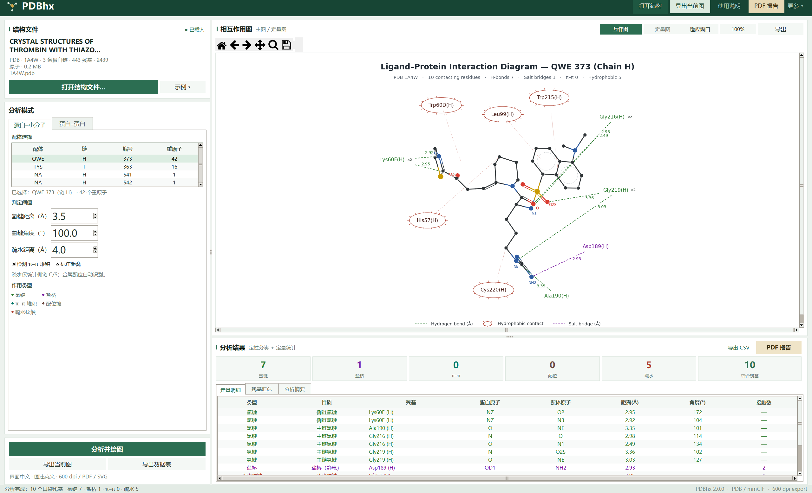

# PDBhx

**蛋白–小分子 / 蛋白–蛋白相互作用可视化与定量分析工具**

PDBhx 是一个面向结构生物学研究的桌面软件：读取 PDB / mmCIF 结构，自动识别氢键、疏水接触、盐桥、π–π 堆积与金属配位，生成可直接用于论文的英文二维示意图与定量图表，并输出中英双语的出版级 PDF 报告。

作者：**aehxing** · 联系方式：**aehxing@163.com**



---

## 主要功能

- **两种分析模式**：蛋白–小分子（配体口袋）与蛋白–蛋白（链间界面）。
- **五类相互作用**：氢键（距离 + 角度）、疏水接触、盐桥、π–π（平行 / T 型）、金属配位。
- **定量评价**：SASA / BSA、逐残基埋藏、配体逐原子埋藏、配体描述符、残基类别组成与富集、热点残基、界面作用密度。
- **出版级绘图**：图内全英文，中文界面；PNG 600 dpi、PDF/SVG 矢量导出。
- **中英双语 PDF 报告**：封面、摘要、图件导读、15 张专业图件（每图含中英文图注与解读）、关键表格、结合参数、方法与参考文献。
- **输入格式**：`.pdb`、`.ent`、`.cif` / `.mmcif`，支持 gzip 压缩；自动读取第一个 MODEL。

## 安装

需要 Python 3.10 或更高版本。

```bash
pip install -r requirements.txt
```

依赖：`numpy`、`matplotlib`、`reportlab`、`Pillow`。PDF 报告在 Windows 上会嵌入微软雅黑、Arial 与 Georgia；其他系统会自动回退到内置中文字体。

## 快速开始

### 1. 启动

```bash
python main.py
```

Windows 也可以直接双击 `启动 PDBhx.bat`。

### 2. 打开结构

- 点击“打开结构”，选择 PDB / mmCIF 文件；或从“示例”菜单载入：
  - `1A4W`：蛋白–小分子示例（配体 QWE）
  - `1BRS`：蛋白–蛋白示例（链 B / E）
- 也可以直接把结构文件拖入窗口。

### 3. 选择分析模式

- **蛋白–小分子**：在配体列表中选择配体，默认选中重原子最多的非水 HETATM 残基。
- **蛋白–蛋白**：指定两条不同的链，默认给出空间上最接近的一对链。

### 4. 调整阈值并分析

在侧栏调整氢键距离/角度、疏水距离、盐桥距离、π–π 距离、金属配位距离与界面距离，点击“分析并绘图”。

### 5. 查看与导出

- 主图 / 定量图切换：`Ctrl+1` / `Ctrl+2`
- 导出当前图：`Ctrl+S`（PNG / PDF / SVG）
- 导出数据：CSV（互作明细 + 残基汇总）
- 生成完整报告：`Ctrl+P`，或点击顶部“PDF 报告”

## PDF 报告包含的 15 张图

| 图号 | 内容 |
| --- | --- |
| 1 | 蛋白–配体 / 蛋白–蛋白相互作用二维示意图 |
| 2 | 残基互作谱与距离分布 |
| 3 | 残基 × 作用类型指纹热图 |
| 4 | 结合界面组成与结合参数 |
| 5 | 埋藏表面积（BSA）分析 |
| 6 | 氢键几何与疏水接触多重性 |
| 7 | 配体逐原子埋藏与元素组成 |
| 8 | 残基–残基相互作用矩阵 |
| 9 | 热点残基识别 |
| 10 | 残基类别富集 |
| 11 | 相互作用网络 |
| 12 | 作用类型 × 残基类别 |
| 13 | 氢键距离–角度联合分布 |
| 14 | 配体埋藏空间图（蛋白–小分子）/ 残基对作用组成（蛋白–蛋白） |
| 15 | 综合指标仪表盘 |

> 图内不包含 A、B 等面板字母，便于直接放入论文后按期刊要求自行标注。

## 判定规则（默认阈值）

| 作用 | 判据 |
| --- | --- |
| 氢键 | 供体–受体重原子距离 ≤ 3.5 Å，D–H···A 角度 ≥ 100°（无显式氢时使用虚拟氢） |
| 疏水接触 | 蛋白侧链 C/S 与配体或另一条链 C/S 原子距离 ≤ 4.0 Å |
| 盐桥 | 正负带电基团距离 ≤ 4.0 Å，按残基对合并 |
| π–π | 芳环质心距离 ≤ 5.5 Å；平行 ≤ 30°，T 型 ≥ 60° |
| 金属配位 | 金属与 N/O/S 距离 ≤ 2.9 Å |
| 界面残基 | 蛋白–蛋白中任意重原子距离 ≤ 4.0 Å |

所有阈值均可在界面中调整。SASA/BSA 采用 Shrake–Rupley 数值积分（1.4 Å 探针、96 个球面点）。

## 项目结构

```
PDBhx/
├── main.py                 # 启动入口
├── 启动 PDBhx.bat          # Windows 启动脚本
├── requirements.txt
├── pdbhx/
│   ├── pdbio.py            # PDB / mmCIF 解析
│   ├── interactions.py     # 相互作用检测
│   ├── analysis.py         # 结果整理与表格
│   ├── sasa.py             # SASA / BSA
│   ├── descriptors.py      # 配体描述符与界面评价
│   ├── render.py           # 二维示意图
│   ├── quant.py            # 定量图
│   ├── reportfigs.py       # 高级分析图
│   ├── report.py           # 中英双语 PDF 报告
│   └── gui.py              # 中文图形界面
├── samples/                # 示例结构
└── examples/               # 示例图件与报告
```

## 示例输出

- [蛋白–小分子报告（1A4W）](examples/example_report_protein_ligand_1A4W.pdf)
- [蛋白–蛋白报告（1BRS）](examples/example_report_protein_protein_1BRS.pdf)
- [二维示意图（1A4W）](examples/example_protein_ligand_1A4W.png)
- [定量图（1A4W）](examples/example_quantitative_1A4W.png)

## 使用说明与限制

- 仅读取第一个 MODEL；水分子不参与统计。
- 结果为基于单一静态结构的描述性几何分析，不等同于结合自由能或亲和力。
- 不同软件、半径与采样密度会产生不同的 SASA/BSA 数值；跨结构比较请保持参数一致。
- 金属配位、π–π 与盐桥判定为启发式规则，建议结合实验数据解读。

## 引用

若在论文或报告中使用 PDBhx，请注明：

> PDBhx: protein–ligand and protein–protein interaction visualization and quantitative analysis. aehxing. https://github.com/aehxing00/PDBhx

## 联系

作者：aehxing  
邮箱：aehxing@163.com  
问题与建议：<https://github.com/aehxing00/PDBhx/issues>
